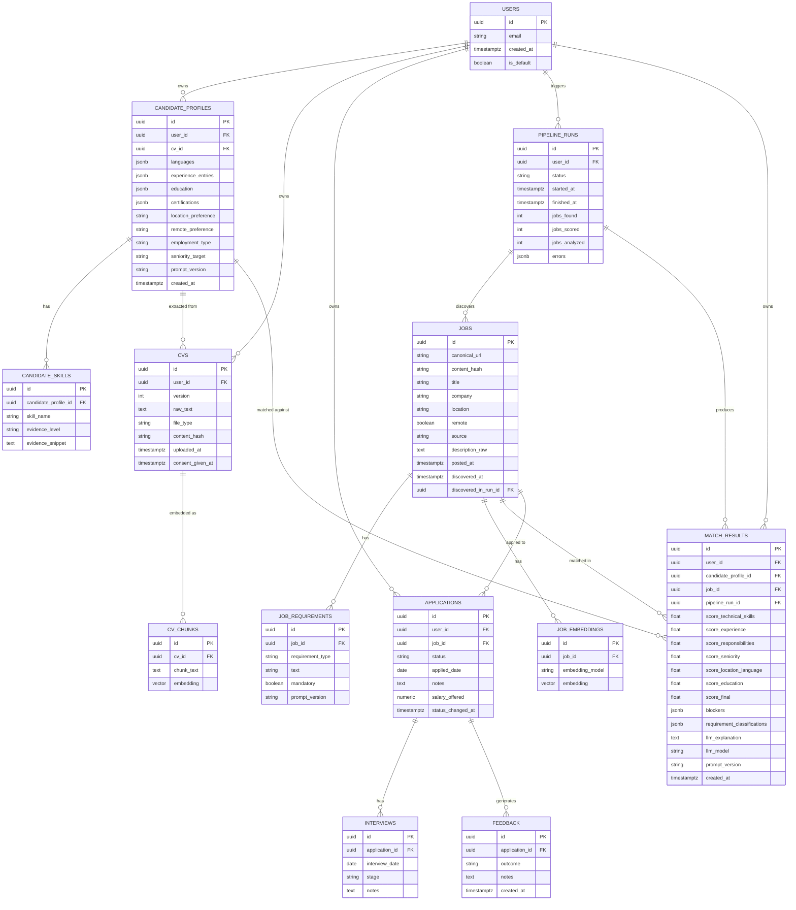

# JobRadar 2.0 - Architecture

JobRadar 2.0 is an incremental upgrade of a working v1 job-search assistant
into an evidence-based, explainable, multi-user job matching system. This
document covers the design goals, the key decisions behind them, the
pipeline and data model, the roadmap the upgrade followed, and the audit of
the v1 codebase that motivated it.

Implementation notes and known gotchas live in
[`DEVELOPMENT.md`](DEVELOPMENT.md); deployment in
[`DEPLOYMENT.md`](DEPLOYMENT.md); data handling in [`PRIVACY.md`](PRIVACY.md).

---

## 1. Goals

1. Extract structured data from CVs and job ads.
2. Rank jobs with a **deterministic, explainable** hybrid score.
3. Use the LLM to *explain* results - never to decide the score.
4. Track applications and their outcomes.
5. Measure recommendation quality against **real** human relevance labels.
6. Be observable: cost, latency, failures.
7. Serve multiple users safely (auth, isolation, GDPR basics, quotas).

## 2. Design decisions

| Topic | Decision | Why |
|---|---|---|
| Database | PostgreSQL + pgvector, Alembic migrations. SQLite only for fast unit tests. | One store for relational data and vectors; real migrations instead of `create_all()`. |
| Vector store | pgvector replaces FAISS. No second production backend. | FAISS was in-process and CV-only; pgvector supports metadata-filtered retrieval over jobs and CVs. |
| Embeddings | `intfloat/multilingual-e5-base` by default; MiniLM selectable via config. | Many postings are German. MiniLM stays available for the v1-vs-v2 evaluation comparison. |
| LLM models | Two tiers via env: `LLM_MODEL_FAST` (extraction, bulk) and `LLM_MODEL_SMART` (explanations). Model IDs never hardcoded elsewhere. | Cost control; swapping models is a config change. |
| Scoring | Weighted hybrid score computed in code. The LLM only explains a score that was already computed. | Reproducible, testable ranking; no opaque "the model said 7/10". |
| Mandatory requirements | A missing mandatory requirement is an explicit **blocker** and caps the score (configurable). | A great average must not hide a hard disqualifier. |
| Job extraction | Extracted once per job, cached by content hash, shared across users. | Jobs are public data; re-extracting per user wastes money. |
| Untrusted input | Job ads are framed as untrusted content in prompts; embedded instructions are ignored. | Prompt-injection defense (verified with an adversarial test posting). |
| Scheduling | APScheduler runs in its own process, separate from the API. | The API stays responsive; the scheduler can be scaled/restarted independently. |
| Background work | arq + Redis for CV extraction and per-user matching. | `POST /cv` and `POST /run` return immediately and are polled. |
| Knowledge graph | MCP memory graph + D3 kept as an optional view; Postgres is the source of truth. | Preserves the v1 visualization without making it load-bearing. |
| Observability | Langfuse tracing, optional via env, PII redacted by default. | Cost/latency/failure visibility without leaking CV content. |
| Evaluation labels | Only real human relevance judgments; never generated, simulated or inferred. Application outcomes are **not** used as labels. | Synthetic labels make metrics meaningless; rejections have many causes unrelated to fit. |
| Public demo | `DEMO_MODE=true` forces mock jobs + a placeholder CV and disables CV upload. | Real CVs never end up in a public deployment, regardless of other env settings. |
| Dashboard | Extend the existing vanilla JS + D3 frontend. No framework rewrite. | Scope control. |

## 3. Engineering principles

- **Incremental**: the app stays runnable after every phase; nothing is rebuilt from scratch.
- **Honest results**: no metric is reported unless it came from an actual run. Evaluation reports state explicitly when the label set is too small (< 40 jobs) to be meaningful. Pricing is not hardcoded - cost estimates are unavailable unless real prices are configured.
- **Privacy**: no secrets or CV content in logs or traces.
- **Integrations behind config**: every optional external service (Langfuse, SMTP, job APIs) is enabled by env and degrades gracefully when absent. `config.py` is the only place env vars are read.
- **Testing**: every feature ships with tests; LLM calls are always mocked (CI runs with an empty API key, so an unmocked call fails fast); Postgres-only tests skip rather than fail when the database is unavailable. Required edge cases: empty/malformed CV, duplicate jobs across sources, invalid LLM output, source API failure, missing mandatory requirement, DB unavailable.
- **Typed boundaries**: type hints throughout, Pydantic at every API/LLM boundary, structured logging.
- **No speculative abstractions**: no interface without a second planned implementation; every new dependency has a stated reason.

---

## 4. Architecture

```
                 ┌──────────────────────────────────────────────┐
                 │                FastAPI (api)                  │
                 │  JWT auth · user-scoped endpoints · rate      │
                 │  limits · per-user LLM quota · D3 dashboard   │
                 └──────┬──────────────────────────────┬────────┘
                        │ enqueue                      │
                        ▼                              │
     ┌────────────────────────────┐   ┌───────────────┴─────────┐
     │  worker (arq + Redis)       │   │  scheduler               │
     │  CV extraction ·            │   │  (separate process,      │
     │  per-user matching runs     │   │   daily pipeline run)    │
     └─────────────┬──────────────┘   └───────────┬─────────────┘
                   └──────────────┬────────────────┘
                                  ▼
                 ┌──────────────────────────────────────────────┐
                 │            LangGraph pipeline                 │
                 │  ingest → dedupe → extract → retrieve         │
                 │        → score → explain → persist → notify   │
                 └──┬─────────┬──────────┬──────────┬──────────┬┘
                    ▼         ▼          ▼          ▼          ▼
               Sources    Extraction   Scoring    Explainer   Delivery
               Arbeitnow  fast LLM,    deterministic smart LLM, digest +
               Adzuna     cached by    hybrid +   from the     MCP graph
               BA, mock   content hash pgvector   structured   (derived
                                       similarity match only   view)
                                  │
                                  ▼
                 ┌──────────────────────────────────────────────┐
                 │          PostgreSQL + pgvector (Alembic)      │
                 └──────────────────────────────────────────────┘
                                  │
                                  ▼
                 Langfuse (optional, PII-redacted) · evaluation/ reports
```

Docker Compose runs six services: `postgres`, `redis`, a one-shot
`migrate`, `api`, `scheduler`, `worker`.

### Scoring

| Component | Weight |
|---|---|
| Technical skills | 0.35 |
| Relevant experience | 0.25 |
| Responsibilities | 0.15 |
| Seniority | 0.10 |
| Location + language | 0.10 |
| Education | 0.05 |

Weights live in config and are validated to sum to 1.0. Skill matches are
weighted by evidence level (professional > academic > personal project >
mentioned only). Semantic similarity is used *inside* the skills and
responsibilities components and for candidate retrieval, never as the
final score. Every requirement is classified `met | partial | missing |
unverifiable` with CV evidence. Only the top N matches get an LLM
explanation, written solely from the structured match result.

### Deduplication

Canonical URL → normalized (title, company, location) → embedding cosine
similarity above a configurable threshold.

### Comparison with v1

| Layer | v1 | v2 |
|---|---|---|
| DB | SQLite, 4 tables, no `user_id` | Postgres + pgvector, every user-owned table carries `user_id` |
| Vector store | FAISS, in-process, CV only | pgvector, job + CV embeddings, metadata-filtered |
| Embeddings | `all-MiniLM-L6-v2` | `multilingual-e5-base` (MiniLM selectable) |
| Scoring | LLM 1–10 holistic score *is* the score | Deterministic weighted hybrid score; LLM only explains it |
| Extraction | Raw dicts | `CandidateProfile` / `JobProfile` (Pydantic) with evidence levels and mandatory vs. preferred |
| Scheduler | In-process inside the API | Separate process |
| Users | Single implicit user | JWT auth, per-user isolation, GDPR export/deletion |
| Observability | Logging only | + Langfuse (cost, latency, prompt version) |
| Dedup | Title + company string match, none across runs | Three-stage, enforced at the DB layer |
| App tracking | Status enum on `Job` | Full 9-status lifecycle, interviews, feedback, Kanban UI |
| CI | None | ruff + mypy + pytest with Postgres service + Docker build |

---

## 5. Data model



Simplified for readability - `database/models.py` is authoritative (it also
keeps the v1 `skill_gaps` table so the existing `/skill-gaps` endpoint keeps
working).

Notes:
* Embedding columns store the model name alongside the vector, so MiniLM
  and multilingual-e5 rows can coexist for evaluation comparisons. HNSW
  cosine-distance indexes cover both `job_embeddings` and `cv_chunks`.
* `jobs`, `job_requirements` and `job_embeddings` are intentionally **not**
  user-scoped: extraction is cached per job and shared. Everything personal
  (`cvs`, `candidate_profiles`, `match_results`, `applications`,
  `pipeline_runs`) carries `user_id`.
* `evidence_level` is one of
  `professional | academic | personal_project | mentioned_only`.
* `Job.status` (legacy, 5 values) and `Application.status` (9-value
  lifecycle) are separate on purpose and not kept in sync.

---

## 6. Roadmap

The upgrade was delivered in phases, each leaving the app runnable.

| Phase | Scope |
|---|---|
| 0 | Audit of the v1 codebase and target design (this document, §7) |
| 1 | PostgreSQL + pgvector + Alembic, SQLite → Postgres data migration, three-stage job dedup, FAISS → pgvector retrieval |
| 2 | Structured extraction: CV → `CandidateProfile`, job ad → `JobProfile`; PDF/text upload with validation; one retry on invalid LLM JSON; versioned prompt files |
| 3 | Deterministic hybrid scoring with blockers and requirement classification; LLM explanations from the structured result; pipeline rewired |
| 4 | Evaluation harness (labeling CLI, Precision@K, Recall@K, NDCG@K, 4-method comparison) + Langfuse tracing with PII redaction |
| 5 | Application tracking: 9-status lifecycle, interviews, feedback, Kanban dashboard |
| 6 | Deployment readiness: multi-stage non-root Dockerfile, separate scheduler service, `DEMO_MODE`, ruff/mypy, GitHub Actions CI |
| 7 | Multi-user (v2.1): FastAPI-Users JWT auth, per-user isolation, GDPR export/deletion, per-user LLM quota, arq workers, rate limiting |

**Status:** all phases implemented. The evaluation harness is in place, but
no real labeled dataset exists yet, so no ranking-quality numbers are
reported yet.

---

## 7. Appendix: v1 audit

Findings from inspecting the v1 codebase (commit `6bd3a12`) before the
upgrade. They motivated most of the decisions above.

### 7.1 v1 execution flow

```
APScheduler (06:00 daily, in-process)  ──┐
                                          ├──▶ run_pipeline()
POST /run (FastAPI, blocks on result) ───┘
                                          │
                                          ▼
                 LangGraph StateGraph (compiled once at import time)
                 scrape → rag → analyst → memory → delivery → persist → END
```

* One process ran the API, the scheduler, the MCP memory client, and the
  embedding model.
* The `analyst` node made one LLM call per job and used its 1–10 score
  directly as the ranking. On invalid JSON the job silently got `score=0`
  with no retry.
* `persist` re-inserted every job on every run - a comment claimed cross-run
  dedup was "handled by the UI layer", but no such logic existed.
* A LangGraph `MemorySaver` checkpointer was configured but never read.
* The dashboard only rendered the knowledge graph; there was no job list
  or application tracking UI.

### 7.2 Risks found

1. **Prompt injection**: raw job descriptions were embedded directly in
   the LLM prompt with no delimiting or instruction to ignore embedded
   instructions, so a malicious posting could manipulate its own score.
   → Fixed in Phase 2 (untrusted-content framing, adversarially tested).
2. **Unauthenticated, cost-bearing endpoint**: `POST /run` triggered paid
   LLM calls with no auth or rate limiting, behind `allow_origins=["*"]`
   CORS. → Fixed in Phases 6–7 (`DEMO_MODE`, auth, rate limiting, quota).
3. **CV leak into git history**: `cv/cv.txt` was tracked and not
   gitignored, while the README told users to paste their real CV into it.
   → Fixed in Phase 2 (gitignored; `cv/cv.example.txt` is the placeholder).
4. **Unused dependencies**: `langchain*`, `aiohttp`, `playwright` had zero
   imports. → Removed in Phase 6.
5. **Silent single point of failure**: the Bundesagentur source falls back
   to a public demo client ID and returns `[]` with only a warning if it is
   ever revoked. (Low risk, documented.)

### 7.3 Test coverage at audit time

15 tests, all passing, but narrow: no coverage of the Adzuna and
Bundesagentur sources, the MCP client/knowledge graph, digest delivery,
`POST /run`, or status updates. v2 added tests alongside every phase.

### 7.4 Migration strategy used

1. Stand up Postgres alongside the existing app; create the full target
   schema with Alembic.
2. Run `scripts/migrate_sqlite_to_postgres.py` against a copy of
   `jobradar.db`: idempotent, backfills a default user, never drops a row
   that doesn't map cleanly (logs it and carries it forward with a
   best-effort default).
3. Verify row counts and spot-check content, then switch `DATABASE_URL`.
   The SQLite file is kept as a backup.
4. Every later schema change is its own Alembic revision with a working
   `downgrade()`.
